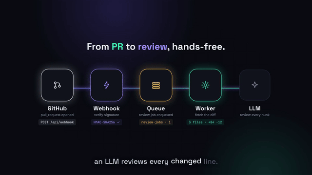
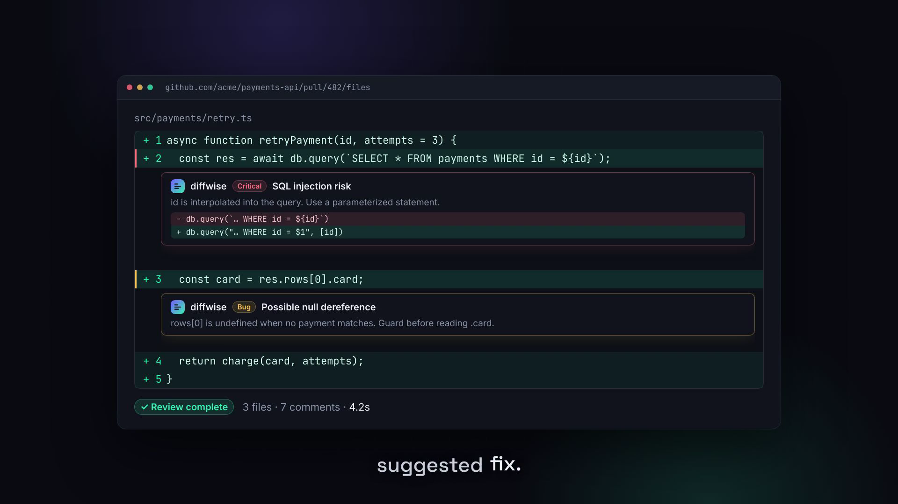

# Diffwise — product demo video

A ~73 s, 1920×1080 (plus 1080×1920 vertical) motion-graphics demo for **Diffwise**, a GitHub App that reviews pull requests with an LLM. Built with [Remotion](https://remotion.dev). The product doesn't exist yet, so every UI is a stylized mock.





Story: problem → install → PR opened → pipeline → comments land → dashboard → roadmap → CTA.

**Outputs** (`out/`): `diffwise-1080p.mp4`, `diffwise-vertical.mp4`, `thumbnail.png`, `preview.gif`.

## Render
```bash
cd diffwise && npm install
npm run dev              # live preview in Remotion Studio
npm run render           # → out/diffwise-1080p.mp4
npm run render:vertical  # → out/diffwise-vertical.mp4
```
Narration: `export GEMINI_API_KEY=...; npm run tts` then re-render. See [developer.md](developer.md) (status: narration pending quota), [BRAND.md](BRAND.md), [script.md](script.md).

Music: none. Fonts: Space Grotesk, Inter, JetBrains Mono (OFL).
