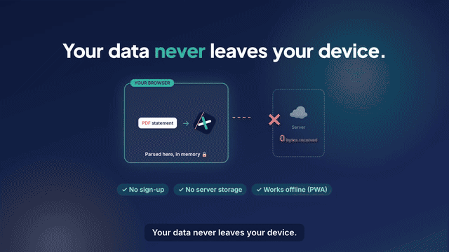

# MF X-ray — product demo video

A ~72 s motion-graphics demo of **MF X-ray**, a privacy-first PWA that helps Indian mutual-fund investors understand their CAS statement (XIRR, fund overlap, expense-ratio drag, direct vs regular, goals, plain-language explainers, AI chat). Built with [Remotion](https://www.remotion.dev). The app isn't built yet, so every screen is a stylised mock with **fictional sample data**.



| File | What |
|---|---|
| `out/mf-xray-demo-1920x1080.mp4` | 16:9 master (YouTube / site) |
| `out/mf-xray-demo-1080x1920.mp4` | 9:16 cut (Instagram / X) |
| `script.md` | voiceover script + scene table |
| `BRAND.md` | logo, palette, typography, name suggestion |
| `developer.md` | how to edit, env vars, decisions, blockers, progress |

Story: hook → upload → privacy promise → XIRR / overlap / hidden-cost reveals → beginner explainers & goals → AI chat → CTA.
Narration: local Kokoro-82M TTS (voice `af_heart`, Apache-2.0) with burned-in captions. No music. *Educational, not investment advice.*

## Render
```bash
cd mf-xray
npm install
npm run studio            # live preview
npm run render            # 1920x1080 -> out/mf-xray-demo-1920x1080.mp4
npm run render:vertical   # 1080x1920 -> out/mf-xray-demo-1080x1920.mp4
```
Needs Node 18+ (Chromium is downloaded by Remotion on first render). Voice regeneration is optional: `npm run voice:setup` once, then `npm run voice` (local Kokoro). An alternative Gemini TTS path exists: `GEMINI_API_KEY=… npm run voice:gemini` (see `.env.example`).
